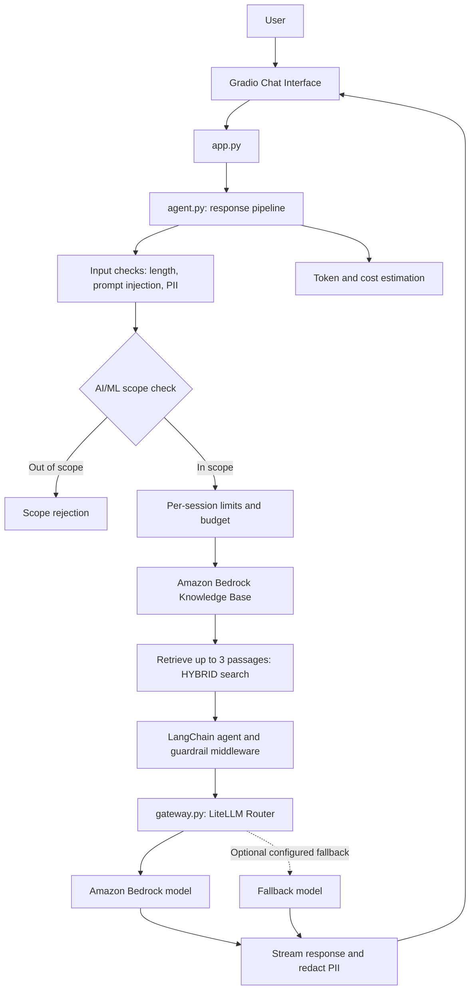

# AWS Production-Ready RAG Chatbot

A streaming **AI Engineering and Machine Learning tutor** built with Retrieval-Augmented Generation (RAG), Amazon Bedrock Knowledge Bases, LangChain, and Gradio. The application retrieves relevant passages from a configured Knowledge Base and uses a Bedrock model to generate answers grounded in that context.

The project also includes input/output guardrails, personally identifiable information (PII) redaction, prompt-injection checks, model routing with optional fallback, and per-session usage limits.

## Overview

The chatbot is intended for questions about:

- Artificial Intelligence and Machine Learning
- Deep Learning and data science concepts used in ML
- LLMs and Generative AI
- RAG, embeddings, and retrieval
- AI agents and AI engineering

A lightweight keyword-based topic check rejects out-of-scope questions before retrieval and model invocation. This is a heuristic, not a semantic classifier.

## Architecture



### Request flow

1. The user submits a question through the Gradio chat interface.
2. Input checks enforce a maximum input length, detect common prompt-injection patterns, and redact recognized PII.
3. A keyword-based scope check allows supported AI/ML questions and relevant short follow-ups.
4. Per-session request limits and a daily estimated-cost budget are checked.
5. The app retrieves up to three passages from the configured Bedrock Knowledge Base using hybrid search.
6. Retrieved passages and recent conversation history are added to the model input. Retrieved passages are treated as reference data rather than instructions.
7. A LangChain agent calls the configured model through a LiteLLM Router. The router retries failures and can use a fallback model when configured.
8. Output middleware and streaming redaction checks are applied while the answer is sent to the Gradio interface.
9. Token usage and estimated cost are recorded in application logs.

## Key features

- **RAG:** Uses passages retrieved from Amazon Bedrock Knowledge Bases to ground answers.
- **Hybrid retrieval:** Requests up to three Knowledge Base results using the `HYBRID` search type.
- **Streaming UI:** Streams model output into the Gradio chat interface.
- **Conversation context:** Includes recent text-based chat history in the prompt.
- **Input guardrails:** Checks input length and common prompt-injection patterns.
- **PII redaction:** Recognizes and redacts patterns such as email addresses, phone numbers, AWS access-key patterns, and other identifiers.
- **Output guardrails:** Uses LangChain agent middleware and streaming redaction to check model output.
- **Model gateway:** Uses LiteLLM Router through `langchain-litellm`, with retries and an optional fallback deployment.
- **Usage controls:** Enforces per-session request limits, requests-per-minute limits, and an estimated daily cost budget.
- **Container support:** Includes a Dockerfile for running the application on port `3000`.
- **Optional tracing:** Supports LangSmith configuration through environment variables.

> **Security and production note:** These guardrails are defense-in-depth measures, not a guarantee against prompt injection, data leakage, or unsafe output. The topic filter is keyword-based, and the included limiter and cost estimator are in-process application controls rather than a distributed quota service. Review and test the application before exposing it to public traffic.

## Tech stack

| Component | Technology |
|---|---|
| Language | Python 3.12 |
| Chat interface | Gradio |
| Agent orchestration | LangChain agents and LangGraph middleware |
| Model gateway | LiteLLM Router via `langchain-litellm` |
| Foundation model | Amazon Bedrock through LiteLLM's Bedrock Converse provider |
| Retrieval | Amazon Bedrock Knowledge Bases |
| Retrieval mode | Hybrid search |
| AWS SDK | Boto3 |
| Guardrails | Custom `guardrails.py` checks and middleware |
| Tracing (optional) | LangSmith |
| Containerization | Docker |

## Project structure

```text
aws_production_ready_rag-main/
├── app.py              # Gradio chat UI and streaming handler
├── agent.py            # Scope check, Knowledge Base retrieval, prompt and agent flow
├── gateway.py          # LiteLLM Router, retries, fallback and usage limits/cost estimation
├── guardrails.py       # Input/output checks, prompt-injection detection and PII redaction
├── dockerfile          # Docker image definition
├── requirements.txt    # Python dependencies
├── pyproject.toml      # Project metadata and dependencies
├── .env_example        # Example environment configuration
├── .dockerignore       # Docker build exclusions
├── .gitignore          # Git exclusions
└── src/
    └── genai_rag/
        └── __init__.py # Package entry-point placeholder
```

## Prerequisites

- Python 3.12 or Docker
- An AWS account with access to Amazon Bedrock
- An existing Amazon Bedrock Knowledge Base with documents ingested and indexed
- A Bedrock model enabled and available in the selected AWS Region
- AWS credentials configured using an AWS-supported credential provider
- Required IAM permissions to retrieve from the Knowledge Base and invoke the selected model

The repository expects the Knowledge Base and its data source to already exist; it does not create or ingest them.

## Configuration

Copy `.env_example` to `.env` in the project root and fill in the values you need:

```env
AWS_REGION=ap-southeast-2
BEDROCK_KNOWLEDGE_BASE_ID=your_knowledge_base_id
BEDROCK_MODEL_ID=your_bedrock_model_id

# Optional: full LiteLLM model string, for example:
# FALLBACK_MODEL=openai/gpt-4o-mini

# Optional router limits
DEPLOYMENT_RPM=60
DEPLOYMENT_TPM=100000

# Optional per-session limits
USER_RPM=5
USER_DAILY_BUDGET_USD=0.50
SESSION_MAX_REQUESTS=4

# Optional fallback prices if LiteLLM has no model pricing
COST_INPUT_PER_1K=0.003
COST_OUTPUT_PER_1K=0.015

# Optional LangSmith tracing
LANGSMITH_TRACING=true
LANGSMITH_ENDPOINT=https://api.smith.langchain.com
LANGSMITH_API_KEY=your_langsmith_api_key
LANGSMITH_PROJECT=your_project_name
```

These are examples and defaults, not required values for every deployment. The application requires `AWS_REGION` (defaults to `ap-southeast-2` in code), `BEDROCK_KNOWLEDGE_BASE_ID`, and `BEDROCK_MODEL_ID`. `FALLBACK_MODEL` is optional. Check current provider pricing before setting cost-estimation values.

For AWS authentication, prefer an AWS profile locally or an IAM role in hosted environments. Although the example file shows AWS credential variables, do not commit credentials or put long-lived secrets in a Docker image. Keep `.env` private.

### IAM permissions

The runtime identity needs permission to retrieve from the configured Bedrock Knowledge Base and invoke the selected Bedrock model. Exact actions depend on your setup. Follow least-privilege IAM practices.

## Run locally

### 1. Clone the repository

```bash
git clone https://github.com/utkarshsingh171/aws_production_ready_rag.git
cd aws_production_ready_rag-main
```

If your repository URL or directory name differs, adjust the commands accordingly.

### 2. Create and activate a virtual environment

**Windows PowerShell**

```powershell
python -m venv .venv
.\.venv\Scripts\Activate.ps1
```

**macOS / Linux**

```bash
python3 -m venv .venv
source .venv/bin/activate
```

### 3. Install dependencies

```bash
pip install -r requirements.txt
```

### 4. Configure environment variables and AWS access

Copy `.env_example` to `.env`, set the Knowledge Base and model identifiers, and configure AWS credentials using an AWS-supported method. Ensure the active identity has the required permissions.

### 5. Start the app

```bash
python app.py
```

The app binds to `0.0.0.0` on port `3000`. Open `http://localhost:3000` in your browser.

## Run with Docker

Build the image from the repository root:

```bash
docker build -f dockerfile -t aws-production-ready-rag .
```

Run it with the required configuration:

```bash
docker run --rm -p 3000:3000 \
  --env-file .env \
  aws-production-ready-rag
```

Make sure credentials are available securely to the container, for example through an appropriate AWS credential setup. Do not bake secrets into the image. Then open `http://localhost:3000`.

## Configuration and operational notes

- Retrieval makes one Bedrock Knowledge Base request for each accepted question.
- The app requests up to three retrieved results and streams a model response.
- The gateway configures two retries and a 60-second timeout. If `FALLBACK_MODEL` is set, the router is configured to use it when the primary deployment fails.
- Rate limits, total session request limits, and estimated spending are stored in process memory. They reset when the process restarts and are not shared across multiple app instances.
- Cost figures are estimates based on token counts and LiteLLM pricing data, or the configured fallback rates. They may not match the final AWS bill.
- Response latency depends on retrieval, model response time, network conditions, AWS Region, and model selection.

## Current limitations

- The AI/ML topic check uses keyword matching and can incorrectly reject relevant questions or accept unrelated questions containing matching terms.
- Knowledge Base setup and document ingestion are external prerequisites.
- Source locations are included in retrieved passage text, but the UI does not provide a dedicated source-citation panel.
- Prompt-injection detection uses pattern matching and cannot catch every attack.
- PII redaction is pattern-based and may miss some sensitive information or redact ordinary text incorrectly.
- Usage limits and cost tracking are in-memory, so they are not durable or globally consistent across replicas.
- Authentication, persistent user accounts, persistent conversation storage, and a formal evaluation suite are not included.
- A Dockerfile is provided, but production hardening, HTTPS, centralized secrets, health checks, monitoring, and deployment automation must be configured for the target environment.

## Future improvements

- Add source citations and retrieval transparency to the chat interface.
- Add a dedicated health-check endpoint and automated deployment pipeline.
- Expand guardrail testing with adversarial and regression test cases.
- Evaluate retrieval quality and answer faithfulness with a repeatable dataset.
- Use shared storage for quotas and usage accounting when deploying multiple replicas.
- Add authentication, persistent session storage, CloudWatch metrics, alarms, and tracing.
- Configure HTTPS and managed secret storage for hosted deployments.

## Contributing

Bug reports, suggestions, and pull requests are welcome. For substantial changes, open an issue first to discuss the proposed update.

## License

No license is currently specified in the repository. Add a `LICENSE` file if you intend to grant others permission to reuse, modify, or distribute the project.

---

**Built with Python, LangChain, Amazon Bedrock, LiteLLM, Gradio, and Docker.**
