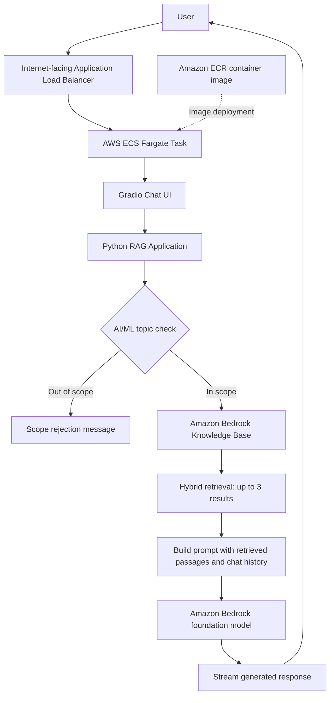

# AWS Production-Ready RAG Chatbot

An AI Engineering and Machine Learning tutor built with **Retrieval-Augmented Generation (RAG)** and deployed as a containerized application on AWS. The chatbot retrieves relevant passages from an Amazon Bedrock Knowledge Base and uses an Amazon Bedrock foundation model to generate grounded, streaming answers through a Gradio chat interface.

## Overview

This project demonstrates an end-to-end cloud deployment of a RAG application, including document retrieval, LLM integration, containerization, and AWS hosting.

The chatbot is designed to answer questions related to:

- Artificial Intelligence and Machine Learning
- Deep Learning and Data Science concepts used in ML
- Large Language Models (LLMs) and Generative AI
- Retrieval-Augmented Generation (RAG)
- AI agents and AI engineering

A lightweight topic check rejects out-of-scope questions before making a Knowledge Base retrieval request or invoking the language model.

## Architecture



### Request flow

1. A user sends a question through the Gradio chat interface.
2. The application checks whether the question is within the supported AI/ML topics.
3. For an accepted question, it retrieves up to three relevant passages from the configured Bedrock Knowledge Base using hybrid search.
4. The retrieved passages and recent conversation history are included in the prompt.
5. The Bedrock model generates an answer, which is streamed back to the chat interface.
6. Out-of-scope questions are rejected without a Knowledge Base retrieval or model call.

## Tech Stack

| Component | Technology |
|---|---|
| Language | Python 3.12 |
| Chat interface | Gradio |
| LLM orchestration | LangChain |
| Foundation model | Amazon Bedrock via `ChatBedrockConverse` |
| Retrieval | Amazon Bedrock Knowledge Bases |
| Retrieval mode | Hybrid search |
| AWS SDK | Boto3 |
| Containerization | Docker |
| Container registry | Amazon Elastic Container Registry (ECR) |
| Container hosting | Amazon ECS with AWS Fargate |
| Traffic routing | Application Load Balancer (ALB) |
| Configuration | Environment variables and `python-dotenv` |

## Key Features

- **Retrieval-Augmented Generation:** Uses retrieved Knowledge Base passages to ground responses.
- **Hybrid retrieval:** Requests up to three results using the Bedrock Knowledge Bases hybrid search configuration.
- **Streaming responses:** Sends generated text to the Gradio UI as model output arrives.
- **Conversation context:** Includes recent user and assistant messages when building the prompt.
- **Topic filtering:** Rejects unsupported questions before retrieval and model invocation.
- **Prompt-injection-aware instructions:** Treats retrieved passages as reference data, not instructions.
- **Containerized deployment:** Packages the app and dependencies into a Docker image.
- **Cloud hosting architecture:** Supports deployment through ECR and ECS Fargate behind an ALB.

> **Security note:** The prompt's instruction to ignore commands inside retrieved passages is a defense-in-depth measure, not a complete prompt-injection or security guarantee. The keyword-based topic filter is also a lightweight heuristic rather than a robust semantic classifier.

## Project Structure

```text
aws_production_ready_rag/
├── app.py              # Gradio chat UI and streaming handler
├── agent.py            # Topic check, retrieval, prompt construction, and LLM calls
├── dockerfile          # Docker image definition
├── requirements.txt    # Python dependencies
├── pyproject.toml      # Project metadata
├── uv.lock             # Locked dependency information for uv
├── .dockerignore       # Files excluded from Docker build context
└── .gitignore          # Git exclusions
```

## Prerequisites

Before running the application, make sure you have:

- Python 3.12+ or Docker
- An AWS account with access to Amazon Bedrock
- An existing Amazon Bedrock Knowledge Base with documents ingested and indexed
- An Amazon Bedrock model available in your selected AWS Region
- AWS credentials configured locally or an IAM role attached to the deployed ECS task
- Docker installed if building or running the container

The Knowledge Base and its data source are assumed to exist already; this repository does not create or ingest them automatically.

## Configuration

Create a `.env` file in the project root for local development:

```env
AWS_REGION=ap-southeast-2
BEDROCK_KNOWLEDGE_BASE_ID=your_knowledge_base_id
BEDROCK_MODEL_ID=your_bedrock_model_id
```

Replace the example values with your own AWS Region, Knowledge Base ID, and supported Bedrock model ID.

**Do not commit `.env` files, AWS access keys, or other credentials to GitHub.** For local development, configure credentials using an AWS-supported method, such as an AWS profile or environment variables. For ECS, prefer a task IAM role and avoid embedding long-lived AWS keys in the image.

### Required AWS permissions

The runtime identity needs permission to retrieve data from the configured Bedrock Knowledge Base and invoke the selected Bedrock model. Exact permissions depend on your model, Knowledge Base setup, and account configuration. Apply least-privilege IAM policies.

## Run Locally

### 1. Clone the repository

```bash
git clone https://github.com/utkarshsingh171/aws_production_ready_rag.git
cd genai_RAG
```

If your repository has a different name or URL, replace the clone URL and directory accordingly.

### 2. Create and activate a virtual environment

**Windows PowerShell**

```powershell
python -m venv .venv
.\.venv\Scripts\Activate.ps1
```

**macOS / Linux**

```bash
python3 -m venv .venv
source .venv/bin/activate
```

### 3. Install dependencies

```bash
pip install -r requirements.txt
```

### 4. Configure AWS access

Configure your AWS credentials using an AWS profile or another supported credential provider. Verify that the identity has the necessary Bedrock permissions.

### 5. Start the chatbot

```bash
python app.py
```

The application listens on port **3000** and binds to `0.0.0.0`. Open the local Gradio URL printed in the terminal.

## Run with Docker

Build the image from the repository root:

```bash
docker build -f dockerfile -t aws-production-ready-rag .
```

Run the container and pass configuration through environment variables:

```bash
docker run --rm -p 3000:3000 \
  -e AWS_REGION=ap-southeast-2 \
  -e BEDROCK_KNOWLEDGE_BASE_ID=your_knowledge_base_id \
  -e BEDROCK_MODEL_ID=your_bedrock_model_id \
  aws-production-ready-rag
```

Make sure AWS credentials are available securely to the container. For local development, you may use a configured AWS profile and mount its credentials directory if appropriate for your environment. Do not bake credentials into the Docker image.

Open `http://localhost:3000` in your browser.

## AWS Deployment

The deployment architecture uses Amazon ECR to store the image, ECS Fargate to run the container, and an internet-facing Application Load Balancer to route HTTP traffic to the service.

### Deployment outline

1. **Configure Amazon Bedrock:** Confirm the Knowledge Base is populated and the chosen model is available in the target Region.
2. **Create an ECR repository:** Use a repository to store the Docker image.
3. **Build and test the image:** Build the image locally and verify the app starts on port 3000.
4. **Push the image to ECR:** Authenticate Docker to ECR, tag the image with the repository URI, and push it.
5. **Create an ECS task definition:** Use the ECR image, set container port 3000, configure the environment variables, and attach a task execution role and task role as needed.
6. **Create an ECS Fargate service:** Run the task in the selected VPC subnets and security groups.
7. **Configure the ALB:** Create a target group for the container port, configure health checks, and attach it to the ECS service.
8. **Configure security groups:** Allow inbound HTTP/HTTPS traffic to the ALB. Allow the ECS task to receive traffic from the ALB security group on the application port. Avoid exposing the task directly to the public internet.
9. **Verify deployment:** Confirm the ECS task is healthy, ALB targets are healthy, logs are available in CloudWatch, and the chat responds through the ALB DNS name.

For a production deployment, use HTTPS with an appropriate certificate, secure secrets management, CloudWatch logs and alarms, and least-privilege IAM permissions. Configure ALB health checks to match an endpoint that the application actually serves.

## Performance Notes

- Retrieval is performed with Boto3 in a worker thread so the synchronous retrieval call does not block the async Gradio event loop.
- The application requests one Knowledge Base retrieval and then makes one streaming model invocation for each accepted question.
- End-to-end response time depends on retrieval latency, model latency, network conditions, AWS Region, and the selected model.
- Streaming improves perceived responsiveness by displaying text as it arrives, but it does not necessarily reduce total generation time.
- Review CloudWatch logs and application timing before changing retrieval settings or model configuration.

## Current Limitations

- The supported-topic filter relies on keywords and conversation context; it may reject valid questions or accept unrelated questions containing AI/ML terms.
- The application assumes the Bedrock Knowledge Base has already been configured and populated.
- The retrieved source location is included in the internal passage text, but the UI does not currently render a dedicated source-citation panel.
- Prompt instructions alone do not guarantee protection against prompt injection or hallucinations.
- Authentication, per-user rate limiting, persistent chat history, and formal evaluation are not implemented in this repository.
- The included Dockerfile is a minimal runtime image; additional production hardening and observability may be needed.

## Future Improvements

- Add structured source citations and retrieval transparency to the UI.
- Add a dedicated health-check endpoint and automated deployment pipeline.
- Add robust input/output guardrails and prompt-injection tests.
- Evaluate retrieval quality and answer faithfulness using a repeatable test dataset.
- Add authentication, rate limiting, and session-aware conversation storage.
- Add CloudWatch metrics, alarms, tracing, and latency breakdowns.
- Use HTTPS and managed secrets for deployment.

## Contributing

Contributions, bug reports, and suggestions are welcome. For significant changes, open an issue first to discuss the proposed improvement.

## License

No license is currently specified. Add a `LICENSE` file before granting others explicit permission to reuse, modify, or distribute this project.

---

**Built with Python, LangChain, Amazon Bedrock, Gradio, Docker, and AWS ECS Fargate.**
